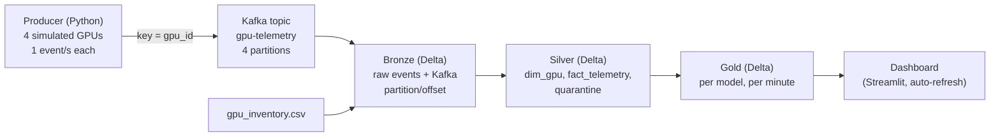

https://github.com/user-attachments/assets/30052133-f713-4f96-bb87-6ea5f072633a

# GPU Telemetry Streaming Pipeline

A small end-to-end streaming data pipeline: simulated GPU telemetry flows through **Kafka** into a
**Spark Structured Streaming + Delta Lake** medallion architecture (bronze → silver → gold), with
data-quality checks and a live dashboard.

I built it to learn Kafka and streaming hands-on and real time BI. Everything runs locally with Docker.

> **All data is simulated.** GPU model names are used for realism only; prices and firmware
> versions are illustrative, not real figures.

**Demo video:** simulated GPU telemetry flowing from Kafka through bronze, silver and gold into the live dashboard, which refreshes as new data arrives (sped up 8x)
---

## Architecture



| Layer | What it does | Tables |
|---|---|---|
| **Producer** | Simulates 4 GPUs (temperature, power, utilization). ~8% of events are broken on purpose: null or impossible temperature, duplicates, unknown GPU. | Kafka topic `gpu-telemetry` |
| **Bronze** | Stores events exactly as received, keeping Kafka's partition, offset and timestamp. Loads the inventory CSV. | `gpu_telemetry`, `gpu_inventory` |
| **Silver** | Parses JSON, validates with SQL, quarantines bad rows with a reason, removes duplicates, MERGEs into a fact table. Builds a GPU dimension. | `dim_gpu`, `fact_telemetry`, `quarantine` |
| **Gold** | Per GPU model per minute: readings, avg/max temperature, energy (kWh), DANGER events (>90 °C). | `model_minute` |
| **Dashboard** | Reads only the gold table, refreshes every 5 seconds. | - |

## Design decisions

- **Key = `gpu_id`.** All events of one GPU go to the same Kafka partition, so their order is kept.
- **Bronze keeps raw data.** If silver logic has a bug, silver and gold can be rebuilt from bronze.
- **Checkpoints everywhere.** Each streaming job saves the offsets it has processed, so a stopped or
  crashed job continues where it left off, with no gaps.
- **Quarantine instead of dropping.** Every rejected event is kept with its reason and raw JSON,
  so data-quality problems can be counted and investigated.
- **Incremental gold.** For each batch of new fact rows, gold recomputes only the minutes those rows
  touch and MERGEs them in. A late event simply corrects its own minute; nothing is recomputed from scratch.
- **Kafka is the short-term buffer** (24 h retention); **Delta tables are the long-term history.**

## Results from a run

Every raw event is accounted for (from one run, `check_silver.py`):

| Where the bronze rows went | Rows |
|---|---|
| Clean rows in `fact_telemetry` | 292 |
| Quarantined (temp out of range 12, unknown GPU 9, missing temp 7) | 28 |
| Duplicates removed | 5 |
| **Bronze total** | **325** |

Kafka partitions (from `check_bronze.py`): each GPU always lands in exactly one partition. With only
4 keys, two GPUs hashed to the same partition and one partition stayed empty. With thousands of
devices the spread evens out.

## Problems I hit and how I fixed them

| Problem | Cause | Fix |
|---|---|---|
| Running Kafka on Windows needs Java and manual setup | Kafka is a Java program that expects a Linux-style environment and its own configuration | Ran Kafka in a Docker container (`apache/kafka` image), started with one command: `docker compose up -d` |
| Running Spark with Delta on Windows needs Java, Hadoop helper files and environment variables | Spark on Windows depends on extra native tools (`winutils.exe`, `HADOOP_HOME`) that are easy to get wrong | Ran Spark in a Docker container (official `spark` image with Java and Python inside), with the project folder shared into it |
| Spark memory warnings when writing several Delta tables | Default 1 GB driver memory | `spark.driver.memory 2g` |

## How to run

Requirements: Docker Desktop, Python 3.10+.

```bash
pip install -r requirements.txt

# 1) start Kafka + Spark and create the topic (first time only)
docker compose up -d
docker compose exec kafka /opt/kafka/bin/kafka-topics.sh --create --topic gpu-telemetry \
  --partitions 4 --replication-factor 1 --bootstrap-server localhost:9092

# 2) start everything in order (bronze -> silver -> gold -> dashboard -> producer)
python run_pipeline.py
```

Dashboard: <http://localhost:8501>. Press **Ctrl+C** once to stop everything in order
(producer first, then a short wait so the last events reach gold).

To inspect each layer while it runs:

```bash
docker compose exec spark /opt/spark/bin/spark-submit pipeline/check_bronze.py
docker compose exec spark /opt/spark/bin/spark-submit pipeline/check_silver.py
docker compose exec spark /opt/spark/bin/spark-submit pipeline/check_gold.py
```

## Project structure

```
docker-compose.yml        Kafka (single broker) + Spark containers
conf/spark-defaults.conf  Spark startup settings: Kafka + Delta packages, memory
data/gpu_inventory.csv    the GPU inventory (dimension source)
producer/produce.py       simulated GPUs -> Kafka
pipeline/01_bronze.py     Kafka -> bronze
pipeline/02_silver.py     bronze -> silver (SQL: validate, quarantine, MERGE)
pipeline/03_gold.py       silver -> gold (incremental per-minute aggregates)
pipeline/check_*.py       look inside each layer
dashboard/app.py          Streamlit dashboard on the gold table
run_pipeline.py           start/stop the whole pipeline in order(mimics orchestrian tools such Airflow)
```

## Next steps

- **Orchestration:** run the layers as Databricks Workflows or Airflow tasks instead of a local launcher.
- **AI agent:** answer plain-language questions ("which model had the most DANGER events today?")
  with read-only SQL over the gold tables.

## Tools

Kafka 3.9 (KRaft), Spark 3.5 (PySpark, Structured Streaming), Delta Lake 3.2, Docker Compose,
Python (`confluent-kafka`), Streamlit. Built with the help of AI coding tools.
